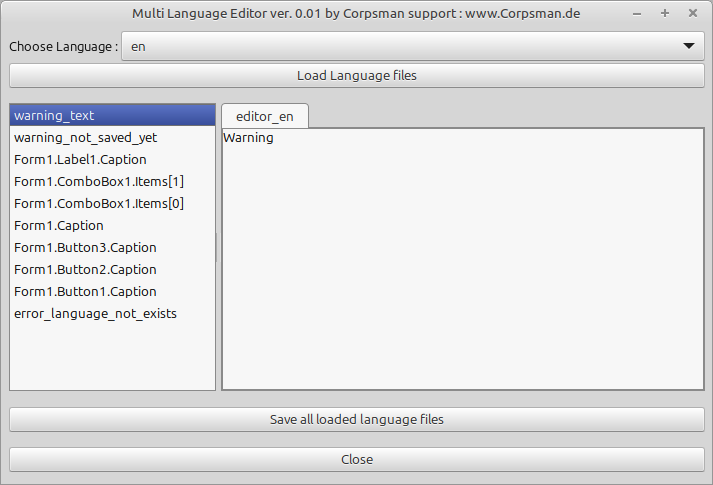

# Multi_Langual

This is the demo app for ulanguage.pas. It is demo and editor in one application, as it shows how to use ulanguage.pas to make a Lazarus application multi langual and at the same time gives easy acces to the files to edit the values :).

Features:

- Load / Save language files
- Switch language during runtime

