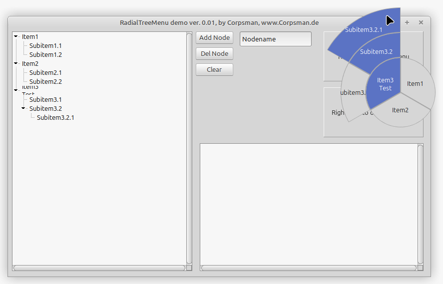

# Radial Tree Menu

Imeplementation of a Radial popup menu.
Tested under Linux GTK2 / GTK3 / QT5 / QT6 and Windows.

Features:
- Add / delete TMenuItems

Dependencies:
- ugraphics.pas
- uvectormath.pas
